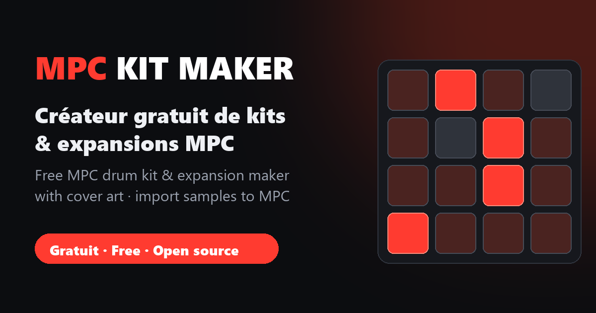

# MPC Kit Maker — Créateur gratuit de kits & expansions MPC / Free MPC Expansion & Drum Kit Maker

**👉 Français : [https://guizmoh.github.io/mpc-kit-maker/](https://guizmoh.github.io/mpc-kit-maker/) · English: [https://guizmoh.github.io/mpc-kit-maker/en/](https://guizmoh.github.io/mpc-kit-maker/en/)**

**⬇ Windows :** [MPC-Kit-Maker-Windows.zip](https://guizmoh.github.io/mpc-kit-maker/downloads/MPC-Kit-Maker-Windows.zip) · ou installez-la comme une appli depuis Edge/Chrome / or install it as an app from Edge/Chrome

---

## 🇫🇷 Français

**MPC Kit Maker** est une application web **gratuite et open source** pour **créer des kits de batterie MPC (.xpm)** et des **expansions MPC avec image de pochette**, et pour **importer facilement vos samples sur MPC**. Elle fonctionne dans le navigateur, sans installation ni inscription. Vos sons ne quittent pas votre ordinateur.

### Fonctionnalités
- Glisser-déposer de samples **ou de dossiers entiers** sur les pads
- **Conversion automatique en WAV** des fichiers MP3, AIFF, FLAC et OGG
- 8 banques (A–H), 128 pads, **plusieurs kits par expansion**
- **Image d'expansion** visible dans la liste des expansions de la MPC (pochette générée si aucune image)
- Bibliothèque de sons avec recherche, écoute et formes d'onde
- **Mode de lecture One Shot ou Note On** pour chaque pad
- Interface en **français et en anglais**
- **Version Windows** : appli installable (hors connexion) ou .zip hors-ligne
- Échange de pads par glisser-déposer, écoute au clic ou au clavier
- Export en `.zip` : expansion complète ou kit seul

### Utilisation
1. Ouvrez l'application : https://guizmoh.github.io/mpc-kit-maker/
2. Glissez vos samples sur les pads.
3. Ajoutez une image de pochette.
4. Cliquez sur **Télécharger l'expansion**.
5. Décompressez et copiez le dossier dans **`Expansions`** à la racine de votre carte SD / clé USB (MPC autonome), ou dans le dossier d'expansions du logiciel MPC.
6. Sur la MPC : **Browser › Expansions**.

### Compatibilité
MPC One / One+, MPC Live / Live II, MPC X / X SE, MPC Key 61, MPC Key 37, MPC Studio, MPC Software 2.x / 3.x (format programme drum `.xpm` + `Expansion.xml`). Testez d'abord avec un petit kit.

---

## 🇬🇧 English

**MPC Kit Maker** is a **free, open-source** web app to **create MPC drum kits (.xpm drum programs)** and **MPC expansions with cover art**, and to **easily import samples into your MPC**. It runs in your browser, with no install and no sign-up. Your samples never leave your computer.

### Features
- Drag & drop samples **or whole folders** onto the pads
- **Automatic WAV conversion** for MP3, AIFF, FLAC and OGG files
- 8 banks (A–H), 128 pads, **multiple kits per expansion**
- **Expansion cover art** shown in the MPC expansion browser (auto-generated if you don't add one)
- Sample library with search, preview and waveforms
- **One Shot or Note On playback mode** for each pad
- **English and French** interface
- **Windows version**: installable app (works offline) or offline .zip
- Swap pads by drag & drop, audition by click or keyboard
- `.zip` export: full expansion or a single kit

### How to use
1. Open the app: https://guizmoh.github.io/mpc-kit-maker/
2. Drag your samples onto the pads.
3. Add a cover image.
4. Click **Download expansion**.
5. Unzip and copy the folder into **`Expansions`** at the root of your SD card / USB drive (standalone MPC), or into the MPC Software expansions folder.
6. On your MPC: **Browser › Expansions**.

### Compatibility
MPC One / One+, MPC Live / Live II, MPC X / X SE, MPC Key 61, MPC Key 37, MPC Studio, MPC Software 2.x / 3.x (`.xpm` drum program + `Expansion.xml` format). Try a small kit first.

---

### ☕ Soutenir / Support

**Cet outil vous a été utile ?** MPC Kit Maker est gratuit et le restera. Un petit café sur Ko-fi m'aide à continuer de l'améliorer.
**Was this tool useful?** MPC Kit Maker is free and always will be. A small coffee on Ko-fi helps me keep improving it.

### Développement / Development
Aucune dépendance : l'appli est entièrement dans `mpc-kit-maker.html`. `tools/build.py` remplit les liens et crée le .zip Windows. No dependencies: the app lives entirely in `mpc-kit-maker.html`; `tools/build.py` fills in the links and builds the Windows .zip. Les contributions sont bienvenues / Contributions welcome!

### Mots-clés / Keywords
créer expansion MPC · logiciel MPC Windows · One Shot Note On MPC · créateur de kit batterie MPC · importer samples MPC · programme drum XPM · expansion MPC gratuite · logiciel gratuit MPC · image expansion MPC · MPC expansion maker · MPC drum kit maker · import samples to MPC · XPM drum program creator · free MPC expansion · MPC expansion cover art · open source MPC tool · Akai MPC sample pack

### Contact
📧 [guizmoh.photo@gmail.com](mailto:guizmoh.photo@gmail.com)

### Licence / License
MIT — voir / see [LICENSE](LICENSE).

> Projet indépendant, non affilié à Akai Professional ou inMusic. « MPC » est une marque de son propriétaire.
> Independent project, not affiliated with Akai Professional or inMusic. “MPC” is a trademark of its owner.
